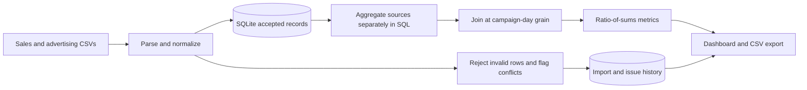

# MarketLens — Sales & Marketing Analytics

[](https://github.com/AshokRana25/sales-marketing-analytics/actions/workflows/ci.yml)

**A local sales and advertising dashboard with repeatable CSV imports, data-quality reporting, auditable SQL, and clearly defined performance metrics.**

The project answers a common analytics question: how do sales outcomes relate to advertising investment, and can the underlying data support that conclusion? It combines a working browser dashboard with an inspectable Python/SQLite pipeline.

## Run in one command

Requires **Python 3.11+**. No third-party Python packages, Node build, API keys, advertising accounts, or internet connection are needed at runtime.

```bash
git clone https://github.com/AshokRana25/sales-marketing-analytics.git
cd sales-marketing-analytics
python -m marketlens
```

Open **http://127.0.0.1:5090**. A new database is automatically seeded with deterministic fictional sales and advertising fixtures. Existing data is preserved on restart.

```bash
# Start with an empty, separate database for your own synthetic files
python -m marketlens --empty --database data/my-demo.db --port 5091
```

`--empty` prevents automatic seeding; it does not delete existing records. This is a local portfolio demo. The server binds only to loopback and is not intended for public production hosting.

## Explore the dashboard

- **Date and channel filters** apply to both sales and advertising data, with inclusive dates.
- **KPI cards** show net revenue, advertising spend, paid ROAS, orders, and average order value.
- **Trend chart** compares daily revenue and spend on a common USD scale. Dots expose values on hover; absent days are not silently filled with zero.
- **Channel contribution** shows each channel's share of selected net revenue.
- **Campaign table** includes orders and platform conversions as distinct measures.
- **Business observations** identify the highest observed paid ROAS, refund impact, and source-coverage gaps. These are deterministic rules, not AI-generated insights or budget recommendations.
- **Data-quality panel** exposes accepted, duplicate, rejected, and normalized counts for the latest import.
- **CSV upload** accepts sales, advertising, or both. Campaign results can be exported as CSV.

## Reproducible sample results

For the complete supplied dataset, **August 1–28, 2026, all channels**:

| Measure | Expected result |
|---|---:|
| Distinct sales orders | 939 |
| Net revenue | USD 79,845.28 |
| Ad spend | USD 14,480.12 |
| Paid ROAS | 3.29x |
| Campaigns | 5 |
| First import accepted rows | 995 (939 sales + 56 ad rows) |
| Duplicate rows skipped | 1 |
| Invalid rows rejected | 2 |

These are fictional fixture results, not business achievements. The sample deliberately includes channel aliases, a duplicate order, an invalid date, a negative amount, one paid campaign-day without an advertising row, and an advertising campaign-day without sales. Reimporting the files does not inflate revenue or spend.

## CSV contracts

Use UTF-8 CSV with a header row. A UTF-8 BOM is accepted. Column order may vary; the set of columns must match the contract. Whitespace around field values is trimmed, channel labels are normalized, and currency is restricted to USD.

**Sales:** one record per globally unique order ID.

```csv
order_id,date,channel,campaign,gross_revenue,refund_amount,currency
SYN-1001,2026-08-01,paid search,Search / High intent,100.00,10.00,USD
```

**Advertising:** one record per date/channel/campaign combination.

```csv
date,channel,campaign,spend,impressions,clicks,conversions,currency
2026-08-01,paid search,Search / High intent,20.00,1000,50,3,USD
```

Supported channels: `paid search`, `paid social`, `email`, and `organic`. Advertising rows must use one of the two paid channels. `search`, `ppc`, and `paid_search` map to `paid search`; `social` and `paid_social` map to `paid social`.

Campaign and order identifiers are trimmed but remain case-sensitive. Campaign names must match across sources for an exact campaign-day match. Files must already use the same reporting-date convention; no timezone or currency conversion is inferred.

### Import rules

1. Validate both file structures before opening a write transaction. A bad header or malformed CSV prevents the entire request from committing.
2. Validate row dates, values, required identifiers, supported channels, currency, and funnel counts.
3. Store monetary values as integer cents; reject negative amounts, fractional cents, nonfinite numbers, and refunds exceeding gross revenue.
4. Require nonnegative integer advertising counts and `conversions <= clicks <= impressions`. This deliberately models a click-based conversion dataset; it does not support view-through conversions.
5. Skip exact duplicate records. Quarantine conflicting keys instead of silently overwriting previous values.
6. Commit accepted rows, import statistics, source-file hash, and issue metadata together.

Quarantine stores dataset name, CSV line number, and reason—not raw rejected row contents. Keep your original file if you need to investigate or correct it. Imports are insert-only; corrections to accepted records require a new clean demo database or a future explicit update workflow. There is no deletion/correction UI.

The browser limits selected files to 1.5 MB combined. The API limits the JSON request to 2 MB, each CSV to 20,000 lines, and individual fields to Python's CSV parser limit. The normalization counter overlaps row outcomes and is not an additional accepted/rejected category.

## Why the SQL matters

Joining individual orders directly to daily ad rows multiplies spend whenever several orders share a campaign-day. [`marketlens/queries.sql`](marketlens/queries.sql) avoids this by aggregating each source first, then joining at **date + channel + campaign**. A union of source keys preserves advertising-only and sales-only periods.



## Metric definitions

| Metric | Formula | Interpretation |
|---|---|---|
| Net revenue | Gross revenue − refunds | Refunds reduce the original order's reported revenue |
| Orders | Count of distinct accepted order IDs | Includes fully refunded orders |
| AOV | Net revenue / orders | Not gross basket value |
| Paid ROAS | Paid-channel attributed net revenue / ad spend | Observed attribution, not incremental lift |
| MER | All selected net revenue / ad spend | Includes email/organic revenue; available in the report API |
| CTR | Sum(clicks) / Sum(impressions) × 100 | Ratio of sums, not average row CTR |
| CPC | Ad spend / clicks | Undefined when there are no clicks |
| Cost per ad conversion | Ad spend / platform conversions | Not unique-customer CAC |

Undefined ratios are `null` in JSON and `—` in the dashboard. A measured zero numerator with a nonzero denominator remains zero. Attribution is a single campaign recorded on each order. Platform conversions can differ from orders; there is no multi-touch, incremental-lift, customer-identity, margin, or lifetime-value model.

See [design decisions and limitations](docs/design.md).

## API and direct SQL

```text
GET  /api/report?start=2026-08-01&end=2026-08-28&channel=paid%20search
POST /api/import   {"sales_csv":"...", "ads_csv":"..."}
GET  /api/health
GET  /api/export?start=2026-08-01&end=2026-08-28
```

The report returns filters, summary, campaign rows, daily totals, observations, latest five import runs, and first 50 issues from the latest run. Import history is database-wide, independent of report filters.

You can inspect `data/marketlens.db` using a SQLite client. Raw SQL for the joined grain is versioned in the repository; report queries use bound parameters.

## Verify and regenerate

```bash
python -m unittest discover -s tests -v
python scripts/generate_samples.py
```

Tests cover join fan-out prevention, paid ROAS versus MER, weighted ratios, integer-cent arithmetic, duplicates, conflicts, atomic structural validation, bad dates and amounts, normalization, missing-source days, persistence, HTTP input limits, and static-file path restrictions. GitHub Actions runs the suite on Python 3.11, 3.12, and 3.13 and checks that regenerated fixtures match Git.

## Repository layout

```text
marketlens/pipeline.py       CSV validation, cleaning, import audit, SQLite storage
marketlens/queries.sql       Campaign-day aggregation and source reconciliation
marketlens/analytics.py      Metric definitions, filters, rule-based observations
marketlens/server.py         Local HTTP API and static assets
marketlens/static/           Responsive dashboard and CSV export
samples/                    Deterministic synthetic input files
scripts/generate_samples.py Reproducible fixture generator
tests/                      Data pipeline and HTTP integration tests
docs/design.md              Architecture decisions and production extensions
```

## Scope

No confidential company data or personal information is included. No external analytics service receives imports. The standard-library HTTP server, local SQLite file, lack of authentication, and bounded upload/report design make this suitable for a local demonstration—not a multi-tenant production service.
